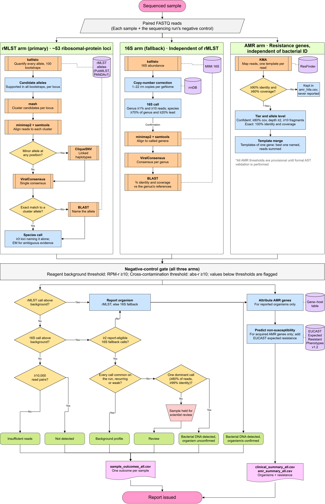

<p align="center">
  
</p>

# BRIDGE

**B**acterial **R**esistance and **ID**entification from **G**enomic **E**nrichment

**Dual-marker bacterial identification and resistance-gene detection from
targeted (hybrid-capture) sequencing.**

BRIDGE takes paired-end reads from a sample sequenced with a bacterial capture
panel and answers three questions per organism: **which bacteria are present,
is each one above the run's own negative-control background, and which
resistance genes does it carry?**

- **Identification from two independent markers.** Ribosomal MLST (rMLST, ~53
  single-copy ribosomal protein genes) resolves species; the 16S rRNA gene
  covers organisms outside the rMLST target set. rMLST governs; 16S is the
  fallback and a cross-check.
- **Negative-control gating.** Every organism (and every resistance gene) is
  compared with what the run's blank held, as a ratio of reads per million
  (RPM-r) for reagent background, or of absolute reads (abs-r) for
  cross-contamination from another sample on the same run.
- **Resistance genes.** ResFinder alleles are called with KMA from the same
  reads, gated against the blank, attributed to an organism using a curated
  gene-host table, and combined with EUCAST expected resistant phenotypes into
  a predicted phenotype per organism.
- **One result per sample.** Every sequenced sample gets one outcome row
  (detected, negative, insufficient reads, failed, ...) and a short
  organism + resistance summary.

One command, `bridge`, runs every arm as a PBS job per sample (or locally) and
then builds the run tables. Thresholds live in `config.yaml`, and changing one
needs only the few-second finalise step, never a re-run of the sequence
analysis.

---

## How it works

<p align="center">
  
</p>

**rMLST arm.** kallisto quantifies the reads against an rMLST allele reference;
candidate alleles are clustered per locus, a consensus (ViralConsensus, or
CliqueSNV haplotypes where a locus holds a mixture) is built per cluster and
matched back to the alleles (BLAST where there is no exact hit), and species
are called from the allele profile. A species is reported only when at least 3
loci name it **and no other species**; near neighbours that fall short are kept
and labelled `alternative_to` rather than deleted. Details:
[docs/rmlst_arm.md](docs/rmlst_arm.md).

**16S arm.** One kallisto pass against the full MIMt 16S database. Reads are
divided by each taxon's rrn operon copy number (rrnDB). A genus is called above
1% of the profile and 10 reads; a species is named only when it holds at least
70% of its genus and leads the runner-up by at least 20 points, so groups 16S
cannot separate (*E. coli*/*Shigella*, *S. mitis* group, *B. cereus* group) are
reported at genus level without any curated exception list. The reads are then
aligned to the called genera's references to report identity and coverage, as
a Sanger 16S report would; this never changes a call.

**Gate.** Reagent contamination ("kitome") is organism-specific and changes
with reagent lots, so each organism is compared with its own level in the
run's negative control(s). An organism is reportable at RPM-r >= 10 (or, where
the blank held it through cross-contamination from a sample on the same run,
abs-r >= 10). Organisms that fail are **kept and labelled** `background`, not
removed. A pooled cross-run baseline can stand in where a run's blank is too
shallow.

**Reconciliation.** If rMLST resolved any species in a sample, the reported
organisms are rMLST's, and 16S attaches to each by genus; a genus only 16S saw
is kept as an informational `16s_only` row. If rMLST resolved nothing, the 16S
calls become the reported set. When several such 16S-only calls are eligible
in one sample they are held for review (`review_override`), since that pattern
is more often unmodelled reagent background than a mixed infection.

**AMR arm.** KMA maps the reads to ResFinder. Alleles above ResFinder's own
read defaults (90% identity, 60% coverage) are classed `confident` or
`partial`, named `exact` or `nearest`, gated against the blank per gene, and
attributed to an organism: the sole reported organism, the one organism the
curated host table says carries the gene intrinsically, or `unassigned` when
short reads cannot tell. Predicted phenotypes combine EUCAST Expected Resistant
Phenotypes (v1.2) with the attributed acquired genes. **Nothing is ever called
susceptible:** absence of a gene is not evidence of susceptibility.
Chromosomal point mutations are not called.

---

## Requirements

- Python >= 3.10 with pandas, numpy, matplotlib, seaborn and PyYAML
- External tools (versions BRIDGE was validated with):

| Tool | Version | Used by |
|---|---|---|
| kallisto | 0.52.0 | rMLST, 16S |
| mash | 2.3 | rMLST |
| minimap2 | 2.31 | rMLST, 16S |
| bwa-mem2 | 2.2.1 | rMLST (optional alternative aligner) |
| samtools | 1.23.1 | rMLST, 16S |
| BLAST+ (blastn, makeblastdb) | 2.11.0 | rMLST, 16S |
| ViralConsensus | 1.0.1 | rMLST, 16S |
| CliqueSNV (+ Java) | 2.0.3 | rMLST |
| KMA | 1.6.6 | AMR |

- A PBS scheduler for `bridge run` (or `--scheduler local` to run in the
  current session).

`bridge check` verifies Python, every binary, every reference file and the
scheduler, and says how to fix what is missing.

## Installation

Either a Python virtual environment, with the tools supplied by your cluster's
module system:

```bash
git clone <repository-url> bridge && cd bridge
./setup_env.sh                 # creates .venv and runs `pip install -e .`
                               # --slim for fewer files, --pinned for requirements.txt, --dev for pytest
source .venv/bin/activate
# edit tools.env for your module system (it is a template), then:
source tools.env
bridge check
```

or a self-contained conda environment that includes the tools:

```bash
conda env create -f environment.yml      # or micromamba create -f environment.yml
conda activate bridge
bridge check
```

and set `tools: tools_env: null` in `config.yaml`. A plain `pip install -e .`
into any Python 3.10+ environment also works when the tools are already on
`PATH`.

Run the tests with `pip install -e .[dev]` and `python -m pytest`.

## Reference databases

BRIDGE does not ship reference data. Download each, then point
`references:` in `config.yaml` at it.

| Key(s) in `config.yaml` | Database | Notes |
|---|---|---|
| `rmlst_alleles`, `rmlst_index`, `rmlst_seqdef` | rMLST alleles and sequence definitions from [PubMLST](https://pubmlst.org/species-id) | Allele FASTA for the genera your panel targets, its kallisto index (`kallisto index`), and the allele-to-species / rST definition table. Access to rMLST data is subject to PubMLST's licence terms. |
| `s16_reference`, `s16_index` | MIMt 16S rRNA database | Use the `_tax_in_id` variant (full lineage in the header, no whitespace) and its kallisto index. |
| `s16_copy_numbers` | [rrnDB](https://rrndb.umms.med.umich.edu/) copy numbers | Build with `bridge build-copy-numbers -i rrnDB-5.x_pantaxa_stats_NCBI.tsv -o rrnDB_copy_numbers.tsv`. Without it every taxon is divided by the same 4.2, which corrects nothing. |
| `amr_db`, `amr_phenotypes` | [ResFinder database](https://bitbucket.org/genomicepidemiology/resfinder_db) | Clone it, then `bridge build-amr-db --db-dir <checkout>` builds the KMA index and records the commit in `db_manifest.json`. `amr_db` is the index *prefix*. |

The curated tables the AMR arm uses (gene-host context, EUCAST expected
resistant phenotypes, gene-family overrides) ship with the package in
`src/bridge/amr/data/`.

The expected resistance table (`eucast_expected_resistant.tsv`) is derived
from the EUCAST Expected Resistant Phenotypes, version 1.2 (January 2023),
published by the European Committee on Antimicrobial Susceptibility Testing
(EUCAST) at <https://www.eucast.org/expert_rules_and_expected_phenotypes>. It
is reproduced here with acknowledgement to EUCAST; the EUCAST document remains
the authoritative source.

## Configuration

Everything is in `config.yaml`; `--config <file>` points any command at another
copy (for example one per site, kept out of version control).

| Block | What it holds |
|---|---|
| `references:` | the reference databases above |
| `tools:` | binary names or absolute paths; `tools_env` is the shell file each job sources (`tools.env`), or null |
| `hpc:` | HPC scheduler settings: `project`, `queue`, `storage`, `python_module`, control-name prefixes, resource tiers by read-file size |
| `rmlst:` | reporting bar (`min_unambiguous_loci`, `require_accepted_consensus`) |
| `marker16s:` | 16S thresholds (`genus_min_frac`, `min_genus_reads`, `species_dominance`, `species_margin`, `alignment_metrics`) |
| `rpm:` | the negative-control gate (`rpm_r_min`, `rpm_min`, `min_ntc_rpm`, `abs_r_min`, `min_sample_reads`, `pooled_baseline`) |
| `reconcile:` | `multi_fallback_review_min` |
| `amr:` | KMA arguments, detection floor, confident tier, resistance gate, curated table overrides |
| `outcome:` | per-sample outcome rules and their wording, and the held-sample split |
| `taxonomy:` | name normalisation and synonyms |

Each setting carries a one-line explanation in the file. Negative controls are
recognised by name prefix (`hpc.controls_prefixes`, default `NEG NTC Blank`,
case-insensitive) or named with `--control`.

## Quick start

```bash
source .venv/bin/activate && source tools.env

# everything the run needs, one line each
bridge check

# one sample, in this session (what each PBS job runs)
bridge sample --sample-id S01 --reads S01_R1.fastq.gz S01_R2.fastq.gz --out results/

# a whole run: one PBS job per sample, then a finalise job that waits for them
bridge run --reads-list sample.list --out results/ --run-id RUN01
bridge run --reads-list sample.list --out results/ --run-id RUN01 --dry-run   # render scripts only

# baseline + reconcile + run tables (seconds; re-run after any threshold change)
bridge finalise --out results/ --run-id RUN01

# rebuild only the per-sample outcomes and clinical summary
bridge outcomes --out results/ --run-id RUN01
```

`--reads-list` holds absolute R1 paths, one per line; the sample name is the
parent directory and R2 is R1 with `_R1_` -> `_R2_` (or `_R1.` -> `_R2.`).
`--reads-dir <dir>` instead discovers `<dir>/<SAMPLE>/*_R1*.fastq.gz`.
`--arms` selects arms: `all` (default), `both` (rMLST + 16S), `rmlst`, `16s`,
`amr`, or a comma list. Re-running `bridge run` is safe: complete samples, and
samples whose jobs are queued or running, are skipped; `--force` redoes the
requested arms. `--scheduler local` runs everything in this session instead of
submitting to PBS.

A step-by-step guide for an HPC cluster, with checkpoints and troubleshooting,
is in [docs/running_on_hpc.md](docs/running_on_hpc.md).

### All commands

| Command | What it does |
|---|---|
| `bridge check` | verify Python, binaries, references and the scheduler |
| `bridge run` | run every sample of a read list (PBS or local), then finalise |
| `bridge sample` | the requested arms for one sample, in this process |
| `bridge finalise` | baseline from the control(s), reconcile every sample, write the run tables, AMR report, outcomes |
| `bridge outcomes` | one outcome per sample and the clinical summary, without re-reconciling; `--tables` works on a copy of the `*_all.csv` tables |
| `bridge amr-report` | re-interpret the AMR arm only (gate, attribution, phenotype) |
| `bridge recurrence` | genus prevalence across runs, used to split held samples |
| `bridge pool-baseline` | one cross-run reagent baseline from several runs' controls |
| `bridge build-baseline` | the baseline step alone |
| `bridge reconcile` | reconcile one sample alone |
| `bridge evaluate` | re-score a run's identification table against a truth table |
| `bridge build-amr-db` | index a ResFinder checkout for KMA |
| `bridge build-copy-numbers` | 16S copy-number table from an rrnDB download |
| `bridge clean` | measure, and with `--apply` remove, intermediates of a finished results tree |

Each command has its own `--help`.

## Outputs

Run-level tables in `<out>/`:

| File | Contents |
|---|---|
| `sample_outcomes_all.csv` | **one row per sequenced sample** on the run's sample list: `outcome` (`detected`, `held_for_review`, `dna_detected_unconfirmed`, `background_profile`, `insufficient_reads`, `analysis_failed`, `not_detected`, `not_run`, `negative_control`), a plain-language statement, depth, flags, and the AMR arm's view |
| `clinical_summary_all.csv` | the short report view: one row per reported organism with its acquired resistance genes grouped by drug class, species-typical (intrinsic) genes, EUCAST expected resistance, and genes that could not be tied to one organism |
| `identification_summary_all.csv` | one row per organism per sample with all the evidence: `basis`, `status`, rMLST locus counts and coverage, 16S margin, abundance, identity and coverage, RPM / RPM-r / abs-r per arm, `rpm_band`, flags |
| `rpm_baselines.csv` | what the negative control(s) held, per arm and organism, and whether each was attributed to reagent background or cross-contamination |
| `amr_summary_all.csv` | one row per resistance gene per sample: allele, identity, coverage, depth, gate verdict, attributed organism, antibiotics, status |
| `predicted_phenotype_all.csv` | organism x agent predictions, with the evidence behind each |
| `amr_baselines.csv` | what the control(s) held, per gene |
| `sample_bacteria.list` | the run's sample list, as written by `bridge run` |

Per sample, in `<out>/<SAMPLE>/`:

```
rmlst/        species_calls.csv, consensus_groups.csv, species_allele_fastas/,
              called_species_pi.pdf, rmlst_manifest.json, rmlst.log
16s/          marker16s_calls.csv, quant/, alignment/<genus>/ (consensus, BLAST hit, depth)
amr/          amr_hits.csv, amr_manifest.json, kma.res / .mapstat / .fsa
bacterial_ID/ reconciled_calls.json, identification_summary.csv
amr_report/   amr_calls.csv, predicted_phenotype.csv
```

Intermediates (alignments, KMA matrices, the rMLST work folder) are removed as
each arm succeeds; `--keep-temp` keeps them.

### Reading the identification table

- **`basis`** says where a row came from: `rmlst` and `16s_fallback` are
  reported calls; `rmlst_alternative` (a second acceptable name for a reported
  organism) and `16s_only` (a genus only 16S saw) are informational.
- **`status`** is a one-word reading of `basis`, the gate and the flags:
  `report`, `review`, `review_override`, or `no_call` for a sample with
  nothing. Only `report` organisms receive resistance genes.
- **`rpm_band`**: `high` (ratio >= 100), `moderate` (>= 10), `background`
  (indistinguishable from the blank; kept, not removed),
  `no_control_background` (the blank never held it, so only an absolute floor
  applied), `ungated` (no baseline for the run). The last two are unchecked,
  not clean.
- **Blank is not zero.** An empty abundance or coverage cell means "not
  measured", never "none".
- **`pi`** (rMLST mixture proportion) ranks organisms correctly but compresses
  toward the middle: use it as a rank, not a percentage. RPM-r compares one
  organism with its own background and must not be used to compare organisms
  within a sample.

## Limitations

- rMLST can only call organisms in its allele reference; 16S covers the rest,
  at lower resolution, and may not separate genera within a family (for example
  among Enterobacterales).
- A single negative control is a point estimate: for organisms seen a handful
  of times in the blank, RPM-r carries real sampling noise around the
  threshold. Sequence controls to a depth comparable to the samples, and
  consider a pooled baseline (`bridge pool-baseline`).
- Short reads cannot link a plasmid gene to its host; attribution states which
  rule it rests on, and leaves genes `unassigned` rather than guess.
- AMR thresholds start from ResFinder's read defaults and should be validated
  against phenotypic AST before clinical use. Point mutations are not called.

## Documentation

- [docs/running_on_hpc.md](docs/running_on_hpc.md): installing and running on
  an HPC cluster, step by step
- [docs/rmlst_arm.md](docs/rmlst_arm.md): the rMLST arm's workflow, options and
  outputs in detail
- `config.yaml`: every threshold, with its rationale

## Citation

If you use BRIDGE, please cite:

> [citation to be added on publication]

Please also cite the tools and databases it depends on: kallisto, Mash,
minimap2, BWA-MEM2, SAMtools, BLAST+, ViralConsensus, CliqueSNV, KMA, PubMLST
rMLST, MIMt, rrnDB, ResFinder and the EUCAST Expected Resistant Phenotypes
(v1.2).

## License

Copyright (C) 2026 

BRIDGE is free software: you can redistribute it and/or modify it under the
terms of the GNU General Public License as published by the Free Software
Foundation, either version 3 of the License, or (at your option) any later
version.

The full licence text is in [LICENSE](LICENSE). The reference databases BRIDGE
reads (PubMLST rMLST, MIMt, rrnDB, ResFinder) and the external programs it calls
are not part of BRIDGE and keep their own licences.
